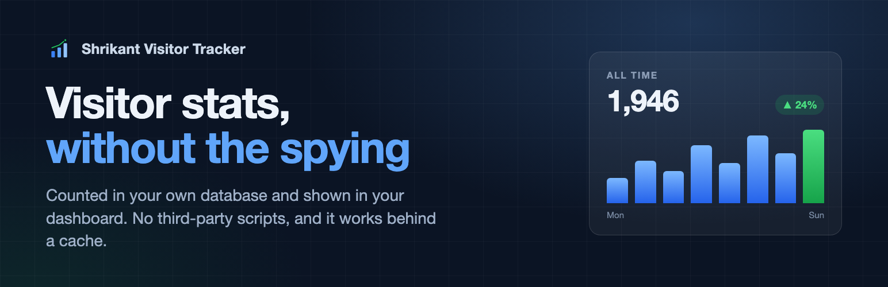
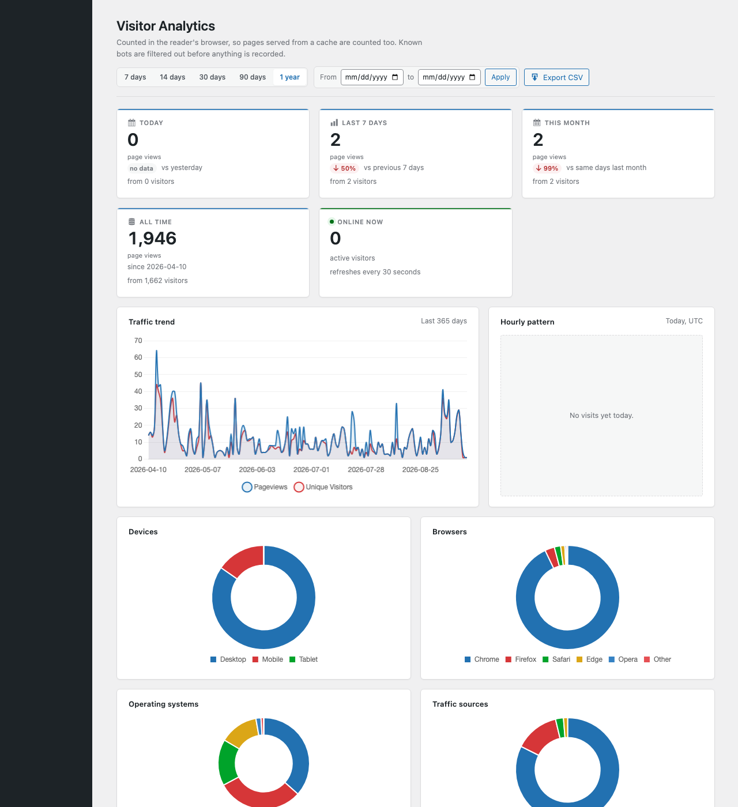
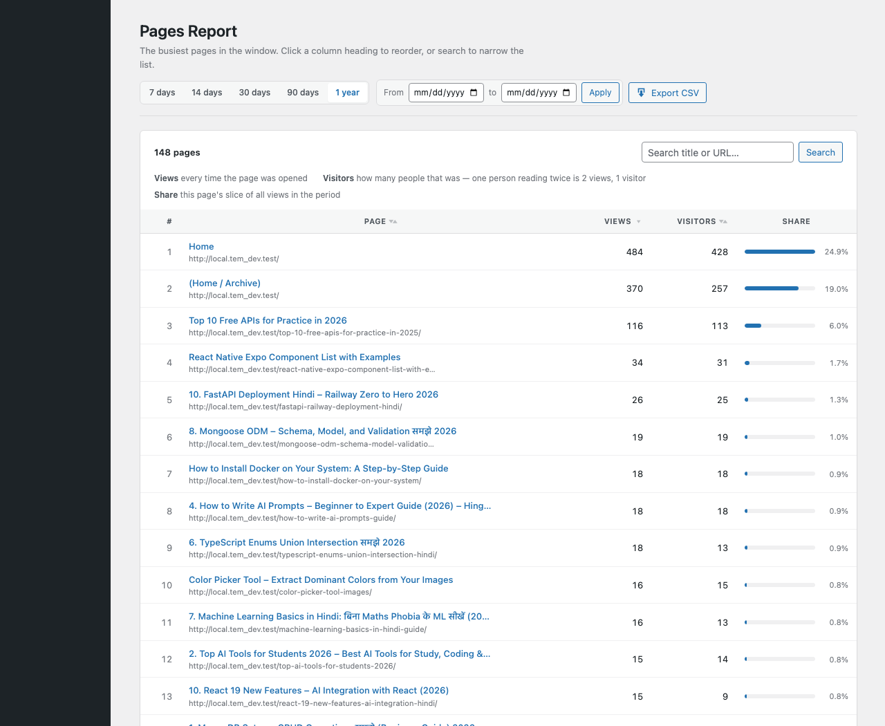
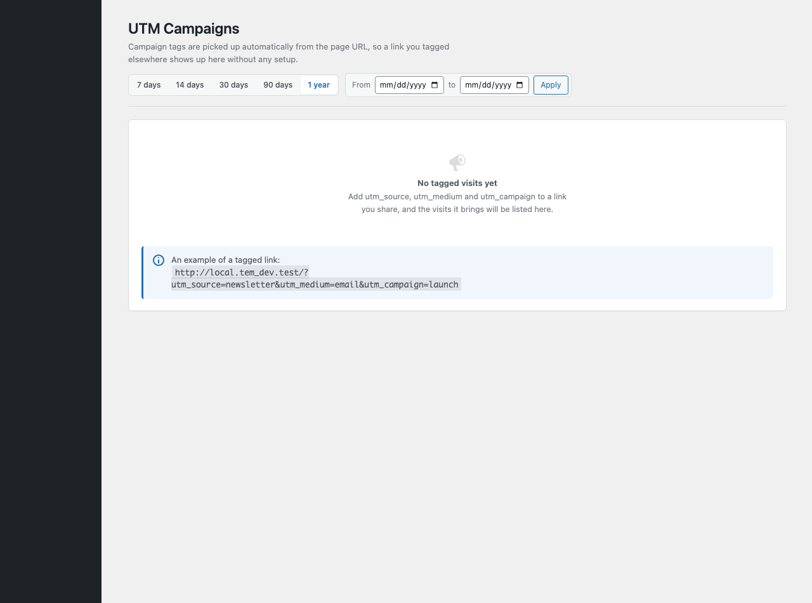
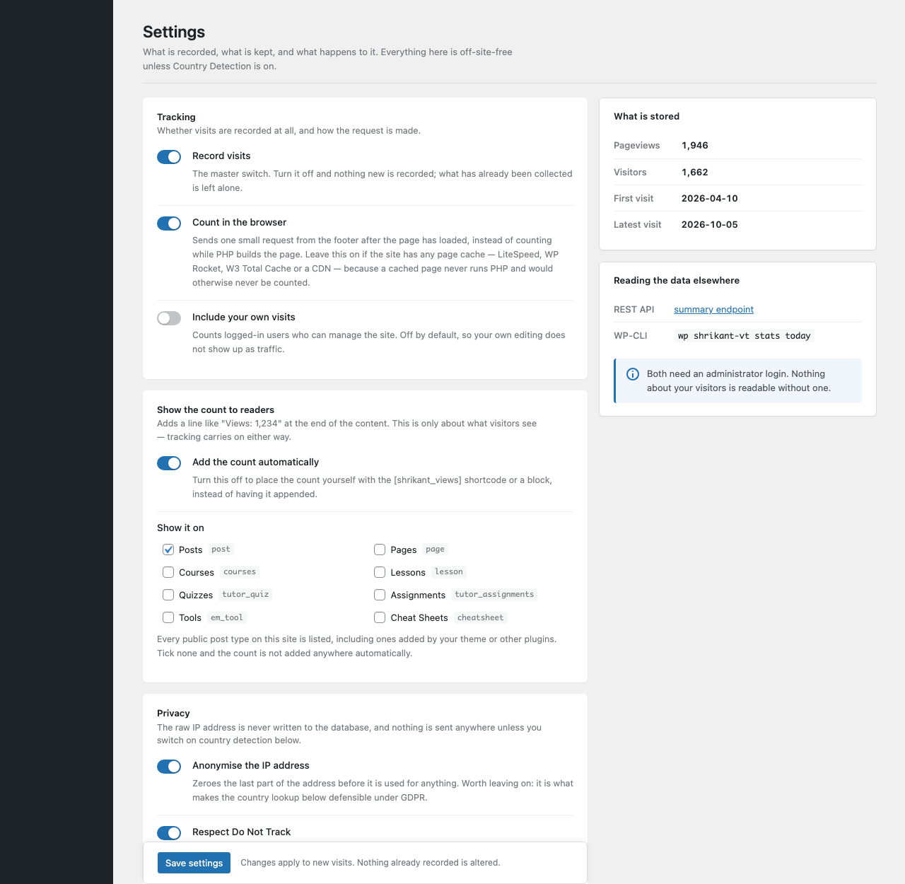
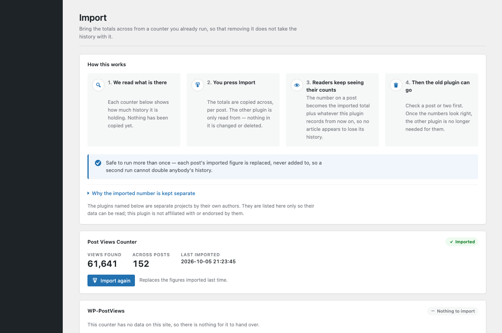

# Shrikant Visitor Tracker

[](https://wordpress.org/plugins/shrikant-visitor-tracker/)
[](https://wordpress.org/plugins/shrikant-visitor-tracker/advanced/)
[](https://wordpress.org/plugins/shrikant-visitor-tracker/)
[](https://wordpress.org/plugins/shrikant-visitor-tracker/)
[](LICENSE.txt)



Self-hosted visitor analytics for WordPress that still counts correctly behind a
page cache, and that can take over from an existing view counter without losing
its history.

**WordPress.org:** https://wordpress.org/plugins/shrikant-visitor-tracker/

**Try it without installing:** [open it in a throwaway WordPress](https://playground.wordpress.net/?plugin=shrikant-visitor-tracker&url=/wp-admin/admin.php%3Fpage%3Dshrikant-visitor-tracker)

## Why it exists

Most view counters increment in PHP while the page is being built. On a site
with a page cache that means readers served from the cache are never counted,
while the crawlers that bypass the cache are counted every time — the number
drifts away from reality in both directions at once.

This one counts from the browser after the page has loaded, and filters known
bots before recording anything. The figure it reports is usually far lower than
the plugin it replaces, and far closer to what Search Console says.

## Switching from another counter

Deleting a view counter normally throws its history away. **Views → Import**
reads the totals out of Post Views Counter or WP-PostViews first. Imported
counts are stored separately and never mixed into this plugin's own statistics:
the two measure different things, and blending them would make both
untrustworthy.

For the same reason, deleting this plugin does not delete its data unless that
is switched on in Settings.

## What it looks like

The dashboard: totals for today, the week and the month, a year of trend,
and the split by device, browser, operating system and source.



Which pages were read, by how many people — sortable, searchable, each with
its share of the total.



UTM campaigns, so a link posted somewhere can be told apart from search
traffic.



Settings. Nothing is collected until you say so: the country lookup is off
until it is switched on, and the view count can be shown on any post type.



Importing from WP-PostViews or Post Views Counter, which counts what will be
brought across before it writes anything.



## Requirements

- WordPress 6.3+
- PHP 8.2+

## Development

`readme.txt` is the file WordPress.org reads; this file is for GitHub and is
excluded from the plugin ZIP by `.distignore`.

## License

GPL-2.0-or-later. Chart.js 4.4.1 is bundled under the MIT license.

## Releasing

Releases go out by hand. The SVN password stays out of GitHub, so git and
the plugin directory remain separate systems: git holds the history, SVN
holds the releases.

**Three places carry the version, and all three must agree** — the plugin
header, `Stable tag:` in `readme.txt`, and the name of the tag directory.
If they disagree the directory serves one version while the page describes
another, and nothing warns you.

```sh
# 1. Bump the version in both files
#    shrikant-visitor-tracker.php   * Version: 1.1.0
#    readme.txt                     Stable tag: 1.1.0

# 2. Copy the plugin into the SVN working copy, minus anything .distignore lists
cd ~/Sites/projects/shrikant-visitor-tracker
rsync -a --delete --exclude-from=<(sed 's|^/||' .distignore) --exclude='.svn' \
      ./ ~/Sites/projects/svn-shrikant-visitor-tracker/trunk/

# 3. A new tag directory, copied from trunk
cd ~/Sites/projects/svn-shrikant-visitor-tracker
rsync -a --exclude='.svn' trunk/ tags/1.1.0/
svn add --force --parents trunk tags

# 4. Send it
svn ci -m "Release 1.1.0" --username shrikantgaur
```

The readme is read from whichever directory `Stable tag` names, **not from
trunk**. A readme corrected only in trunk changes nothing anybody sees, so
a text fix has to be copied into the current tag as well.

Artwork for the directory page lives in `.wordpress-org/` and is copied to
`assets/` in SVN. It is excluded from the plugin ZIP: a banner has no
business being downloaded by every user of the plugin, forever.
